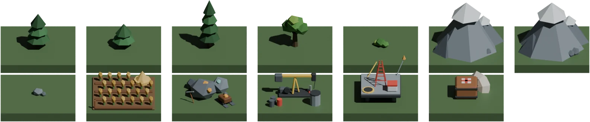

# Environment and resource models

Made in Blender by `env.py` (low-poly, flat colours, same pipeline as `art/units`).

| Model | Used for |
|---|---|
| PINE, PINE2, FIR, OAK, BUSH | Forest tiles (mixed per tile) |
| MTN1, MTN2 | Mountain tiles |
| ROCKS | Scattered boulders on plains |
| CROP | Crop resource: field, furrows, wheat, haystack |
| ORE | Ore resource: rocks, veins, mine cart, pickaxe |
| PUMP | Oil on land: pumpjack (the `beam` piece rocks in game) |
| RIG | Oil at sea: offshore rig with derrick and helipad |
| DROP | Supply drop: crate with parachute |

Rebuild:
```
python env.py            # writes env.json
python env.py render     # also renders env_lineup and saves env.blend
python integrate_env.py ../../gridline-command.html
```


