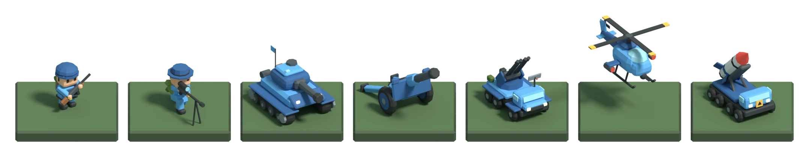

# Unit models



Low-poly unit models for Operation Foothold, built in Blender from a Python script.

| File | What it is |
|---|---|
| `units.py` | Builds all seven units (INF, SNP, TNK, ART, AA, HEL, NUKE) in Blender. Exports `units.json` and can render previews. |
| `units.blend` | The models as a Blender scene, laid out on tiles. Open it in Blender 5.x. |
| `units.json` | The packed models the game uses. |
| `integrate.py` | Writes `units.json` into `operation-foothold-final.html`, replacing the unit builders. |

## Conventions

- Models are authored in game space: x right, y up, +z facing, ground at y = 0. One tile is 1 × 1.
- The `body` and `trim` materials are recoloured per faction in the game. Every other material keeps its palette colour.
- `rotor`, `tailRotor` and `radar` are separate pieces with their own pivot. The game's render loop spins them.

## Editing a unit

You need Blender as a Python module (`bpy`). Python 3.13 needs `bpy` 5.1 or newer.

```sh
python3 -m venv .venv && .venv/bin/pip install bpy
.venv/bin/python art/units/units.py /tmp/units render      # models + Cycles renders + units.blend
cp /tmp/units/units.json /tmp/units/units.blend art/units/
python3 art/units/integrate.py operation-foothold-final.html art/units/units.json
```

Use `quick` in place of `render` for a fast single-lineup preview. Leave both off to export `units.json` only.
